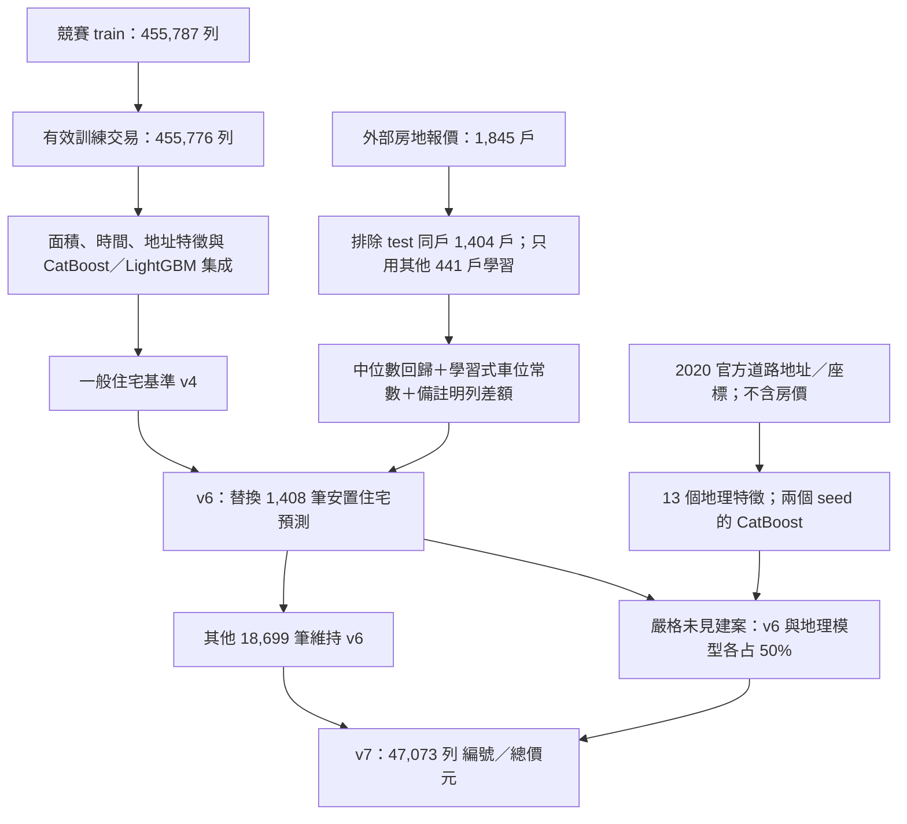
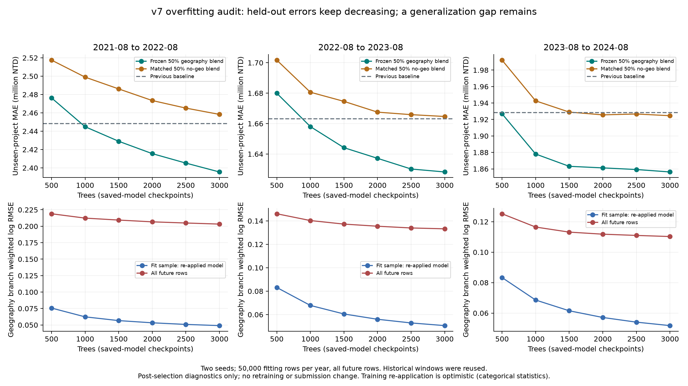

# 314580075｜ML2026@IAII - Regression｜Kaggle 1 Competition

**學號**：314580075　**姓名**：黃駿甯

**GitHub**：snoopyjim　**提交 email**：adogg5528@gmail.com

**主提交**：[submission1017_v7.csv](submissions/submission1017_v7.csv)　**備選**：[submission1017_v6.csv](submissions/submission1017_v6.csv)

**報告**：[技術細節](README_TECH_DETAIL.md) · [PDF](report/report.pdf) · [完整重現條件](REPRODUCIBILITY.txt)

本文件記錄最終 v7 的資料、模型、推論、評估與產物，並說明每個階段的作用。官方指標是新臺幣總價的 **MAE，越低越好**。v7 的使用者回報 public MAE 為 **1,716,414.5323 元**；private score 未知。

本 repo 提供程式、聚合證據與提交 CSV。乾淨 checkout 可完成檔案檢查及合成測試；完整模型重現另需原始資料、外部來源快照及約 4.5 GB 研究快取，尚未提供一鍵從零重訓包。

## 0. 整體流程一覽



| 階段 | 主要程式 | 產物／用途 |
|---|---|---|
| 資料快取與稽核 | [prepare.py](project/prepare.py) | train／valid／test Parquet、原檔雜湊與欄位統計 |
| 一般住宅模型 | train／robust／hedonic／shift 系列 | 凍結的前期模型、時間回測與 v4 基準 |
| 學習式政策分支 | [train_policy_learned.py](project/train_policy_learned.py) | 排除查詢同戶後訓練的模型；v6 |
| 非價格地理增量 | [geography_features.py](project/geography_features.py)、[train_geography.py](project/train_geography.py) | 位置參考、跨年度對照、兩個 seed；v7 |
| 保存模型重現 | [verify_geography.py](project/verify_geography.py) | 從原始 test 重建特徵，核對全部 v7 預測 |
| 泛化診斷 | [audit_overfitting_v7.py](project/audit_overfitting_v7.py)、[audit_policy_generalization.py](project/audit_policy_generalization.py) | 樹數檢查點、留基地／留來源與無查表檢查 |

## 1. 資料與前置條件

| 資料 | 筆數 | 角色 |
|---|---:|---|
| 原始 train | 455,787 | 原始 Excel 內容 |
| 有效 train | 455,776 | 移除 3 列英文說明及 8 列日期無效／超出範圍交易；沒有按價格高低刪除 |
| 官方 valid | 11,994 | 不併入 fitting；其分布不能代替未來一年回測 |
| test | 47,073 | 2024-08-11 至 2025-07-31，無成交價標籤 |
| test 安置住宅 | 1,408 | train 沒有對應交易；由學習式政策分支處理 |

原始資料需放入 `project/data/`：

```text
train-v2.xlsx
valid-v2.xlsx
test-reindex-test-v2.2.xlsx
test-reindex-test-sample-submission-v2.csv
```

`prepare.py` 負責快取與稽核；有效訓練交易的篩選由後續訓練資料流程執行。`evidence/` 保存聚合紀錄，不能直接改名為訓練程式需要的 `artifacts/`。原始競賽檔、逐筆驗證標籤、逐戶外部報價與大型模型不隨本 Git 包提供。

## 2. 為什麼採用這個架構

| 問題 | 處理方式 | 驗證理由與限制 |
|---|---|---|
| test 是未來交易，市場會變動 | 面積尺度、歷史時間因子與三年度前向回測 | 使用原價 MAE 選模；歷史窗口曾被重用，仍有選模偏誤 |
| 未見建案缺少同建案價格資訊 | 加入固定年份的道路位置特徵 | 比較相同權重的有／無地理特徵模型，避免只把多一個模型的效果當成地理增益 |
| train 無安置住宅 | 用其他戶的外部報價學習物理特徵 | test 同戶在 fitting 與選模前排除；報價 MAE 仍不是成交價 MAE |
| 容易依 public 成績反覆調整 | 凍結候選、權重及採用門檻，再做第二 seed 與第三年度確認 | 不依 public 調整特定建案；仍不能宣稱 private 最佳 |

v5 曾直接依戶別查外部配售價，已依「必須學習、不能查答案」的要求淘汰。正式候選是 **v6 與 v7**。政策模型推論不讀逐戶價表；備註明列減收差額則是確定性帳務計算，不能稱為訓練出來的部分。

## 3. 環境與乾淨 checkout 檢查

原研究環境為 Python 3.13、CatBoost 1.2.10、LightGBM 4.7.0、scikit-learn 1.9.1；固定版本見 [requirements.lock.txt](project/requirements.lock.txt)。

在 repo 根目錄：

```bash
python3 scripts/verify_package.py
python3.13 -m venv .venv
.venv/bin/pip install -r project/requirements.lock.txt
cd project
OMP_NUM_THREADS=4 OPENBLAS_NUM_THREADS=1 ../.venv/bin/python -m pytest -q
```

本提交包已在原研究環境通過 **46 項合成測試**，不是重新安裝環境後的全量模型重訓。測試涵蓋時間／標籤隔離、類別編碼、分組、採用門檻、安置戶排除與推論行為。`verify_package.py` 只需標準函式庫，會核對 165 份來源副本、兩份 CSV 與聚合數值。

地理 CatBoost 訓練指定 NVIDIA GPU，其他診斷亦使用 CPU。更換 GPU 或改用 CPU 重訓不保證位元組相同；已驗證的是保存模型的推論重現。

## 4. 訓練階段與凍結設定

### 4.1 前期一般住宅基準

依賴順序為：

```text
prepare.py → train.py / finalize_mae.py
           → train_robust.py / select_robust.py
           → train_spatial.py / train_hedonic.py / select_hedonic.py
           → train_transfer.py / train_shift.py / select_shift.py
```

各輪保留前輪模型、特徵與選擇紀錄。v4 的已見建案部分混合 v3 與新的 LightGBM 分支各半，未見建案沿用 v3。這是多輪研究的依賴關係，不能直接在缺少快取的 checkout 執行最後一輪。

### 4.2 學習式安置住宅分支（v6）

1. 解析公開手冊，統一面積單位與已公開的價格政策版本。
2. 以正規化建案／戶號排除 test 的 1,404 個同戶身分，剩下 441 戶、10 個基地。
3. 比較單價中位數、正則化中位數回歸、淺層 L1 樹，以巢狀整基地交叉驗證評估。
4. 最終選擇六個物理特徵的中位數回歸；車位常數由 2,090 筆車位報價學得。
5. 只替換 1,408 筆安置住宅，其餘 45,665 筆沿用 v4。

| 設定 | 值 | 用途 |
|---|---|---|
| 最終模型 | StandardScaler → QuantileRegressor | 特徵縮放由當折 fitting 資料估計 |
| quantile／alpha | 0.5／0.001 | 預測條件中位數並限制係數 |
| 原始外層／內層 | 5 折／3 折；整基地分組 | 評估選模程序，避免同基地分到兩側 |
| 採用規則 | 每基地等權 MAE；距最佳 1% 內優先簡單模型 | 避免大基地單獨主導選模 |
| 車位常數 | 每位 950,000 元 | 從車位報價學得的全域中位數 |

資料排除、權重公式與推論例子見 [技術細節](README_TECH_DETAIL.md)。原始巢狀驗證與後續追加診斷使用不同切分，報告分別列出。

### 4.3 非價格地理分支（v7）

| 設定 | 值 | 用途 |
|---|---|---|
| 外部來源 | 2020 官方事故地址／座標，清理後 360,521 筆 | 建立道路位置參考，不使用外部房價 |
| 新增特徵 | 13 個 | 位置、定位品質、區域距離與參考點密度 |
| CatBoost | depth 8、3,000 輪、learning rate 0.045、L2 10 | 固定容量；沒有在確認集重新找停止點 |
| seeds | 20261017、20261018 | 檢查增益是否依賴單一隨機種子 |
| 混合候選 | 25%、50% | 使用凍結的跨年度門檻選擇 |
| 最終混合 | 地理模型 50%＋v6 50% | 僅作用於嚴格未見建案，排除安置住宅 |

完整設定：[config.json](evidence/geography_v1/config.json)。地理模型採用加權對數 RMSE 訓練，**以原價 MAE 評估與選擇**；不能把它稱為直接優化 MAE 的模型。

以下為地理階段的程式入口，僅可在已還原前期模型、全部來源快照及凍結輸入後執行；程式會檢查雜湊，不是乾淨 checkout 的完整訓練指令：

```bash
# 工作目錄：project/；已還原 REPRODUCIBILITY.txt 列出的研究資產
python geography_features.py
python train_geography.py all
```

## 5. 推論與最終 CSV

v7 使用 28,374 筆嚴格未見建案的地理增量：

```text
未見建案且不是安置住宅：0.5 × v6 + 0.5 × mean(兩個地理 CatBoost)
其他 18,699 筆：維持 v6，其中包含全部 1,408 筆安置住宅
最後依原 test ID 順序輸出，總價四捨五入為整數
```

還原資料、保存模型與歷史 CSV 後，在 `project/` 執行：

```bash
OMP_NUM_THREADS=12 OPENBLAS_NUM_THREADS=1 python verify_geography.py
```

此程式從原始 test 重建特徵、載入保存模型並核對全部 v7 預測，不重新 fitting 房價模型。它也會檢查欄名、ID 順序、正價格、固定分支不變及提交雜湊。若只要確認已提供的提交檔，使用 repo 根目錄的 `python3 scripts/verify_package.py` 即可。

輸出規格為 **47,073 列資料＋header**，兩欄為 `編號,總價元`。已提供的 v6／v7 各有 47,073 個唯一 ID，價格皆為正整數。

## 6. 結果與過擬合診斷

### 6.1 使用者回報 Public MAE

| 版本 | Public MAE（元） | 狀態 |
|---|---:|---|
| 原版 | 2,393,304.6257 | 初期候選 |
| v2 | 2,188,394.3386 | 歷史候選 |
| v3 | 2,092,770.8572 | 歷史候選 |
| v4 | 2,043,963.0611 | 一般住宅基準 |
| v5 | 1,739,081.1170 | 逐戶查表，已淘汰 |
| v6 | 1,745,458.0575 | 學習式政策分支；備選 |
| **v7** | **1,716,414.5323** | **主選** |

資料來自使用者截至 **2026-10-18** 的回報，未獨立取得官方評分紀錄。v7 相對 v6 改善 **29,043.5252 元（1.66%）**。兩份候選的政策分支完全相同，因此不能分散這個分支的共同風險。Private score 與最終名次未知。

### 6.2 前向時間回測

| 未來評估期間 | 一般住宅基準 MAE | v7 對應方法 MAE | 整體改善 |
|---|---:|---:|---:|
| 2021-08-11～2022-08-10 | 2,267,217 | 2,222,048 | 1.99% |
| 2022-08-11～2023-08-10 | 1,308,238 | 1,285,717 | 1.72% |
| 2023-08-11～2024-08-10 | 1,440,869 | 1,399,774 | 2.85% |

歷史窗口曾在前期研究使用，不是全新獨立測試；也沒有安置住宅成交標籤。12 個保存 CatBoost 模型的 500–3,000 棵樹診斷中，三年度地理集成的未見建案 MAE 持續下降，但約 45% 的未見建案仍退步，2022 年城市群組重抽樣改善區間包含零。



### 6.3 安置住宅泛化檢查

| 追加測試 | 基準報價 MAE | 模型報價 MAE | 改善 |
|---|---:|---:|---:|
| 整基地留出 | 293,780 | 243,592 | 17.08% |
| 相關基地合併留出 | 293,811 | 243,835 | 17.01% |
| 整份手冊留出 | 288,891 | 269,994 | 6.54% |
| 基地留出＋相似樣本排除 | 291,711 | 243,874 | 16.40% |

全部只評估原 441 戶安全標籤，指標是**房地報價 MAE，並非 test 成交價 MAE**。結果支持同政策制度內的跨基地學習；跨來源改善區間仍包含零，不能外推為所有安置制度都有效。

詳細證據：[過擬合報告](evidence/overfitting_v7/REPORT.txt)、[政策泛化報告](evidence/policy_generalization_v1/REPORT.txt)。還原完整研究資產後可重跑：

```bash
# 工作目錄：project/
OMP_NUM_THREADS=8 OPENBLAS_NUM_THREADS=1 python audit_overfitting_v7.py
OMP_NUM_THREADS=4 OPENBLAS_NUM_THREADS=1 python audit_policy_generalization.py
```

後者會訓練診斷模型，但不替換 v6／v7 的正式模型或提交檔。

## 7. 檔案清單與可重現範圍

```text
README.md                  整體流程、設定、執行條件與結果
README_TECH_DETAIL.md      資料轉換、數學、推論案例與泛化驗證
REPRODUCIBILITY.txt        原始資料、保存資產與完整重現限制
report/                   PDF、LaTeX 與圖表
project/                  原研究程式與 46 項合成測試
evidence/                 凍結設定、聚合驗證、來源與雜湊
submissions/              v6／v7 CSV
scripts/                  包內驗證與 PDF 建置
copied_sources.json       165 份原研究來源副本的雜湊
publication_status.json   GitHub 發布與參考格式核對紀錄
```

歷史 JSON 中的 `public_mae: null` 保留當時尚未提交的狀態，後續成績另見 [leaderboard_history.json](evidence/leaderboard_history.json)。模型與凍結程式維持原內容；本次參考格式調整只更新文件及發布紀錄。

## 8. 外部資料、限制與報告格式來源

- 道路資料只使用地址、座標與年份；來源檔宣告於 2021-07-01 提供，但目前下載位元組未獨立認證為當年原始快照。
- 政策手冊部分晚於 train 截止日、早於受影響交易。不能宣稱所有外部資訊都在 train 截止前已知。
- 方法遵循使用者「外部資料用於學習、不得查 test 同戶答案」的要求；未取得完整課程規則，不宣稱主辦方已認定合規。
- 報告整理、程式實作與診斷使用 AI 輔助；不宣稱零過擬合、private 最佳或已取得第一名。

文件配置參考指定 repo 的 [README](https://github.com/Deep-Learning-NYCU/kaggle-3-reasoning-llm-sft-grpo-jimhuang0731/blob/74c08f6f3fa1cbe09498fc45d377c7c10f7d5bfc/README.md) 與 [README_TECH_DETAIL](https://github.com/Deep-Learning-NYCU/kaggle-3-reasoning-llm-sft-grpo-jimhuang0731/blob/74c08f6f3fa1cbe09498fc45d377c7c10f7d5bfc/README_TECH_DETAIL.md)：主文件說明流程與操作，技術文件追蹤資料、公式與實作。已使用 jimhuang0731 讀取核對；參考 repo 的讀者仍需自身存取權。房價數據、方法與結論均取自本專案證據。
