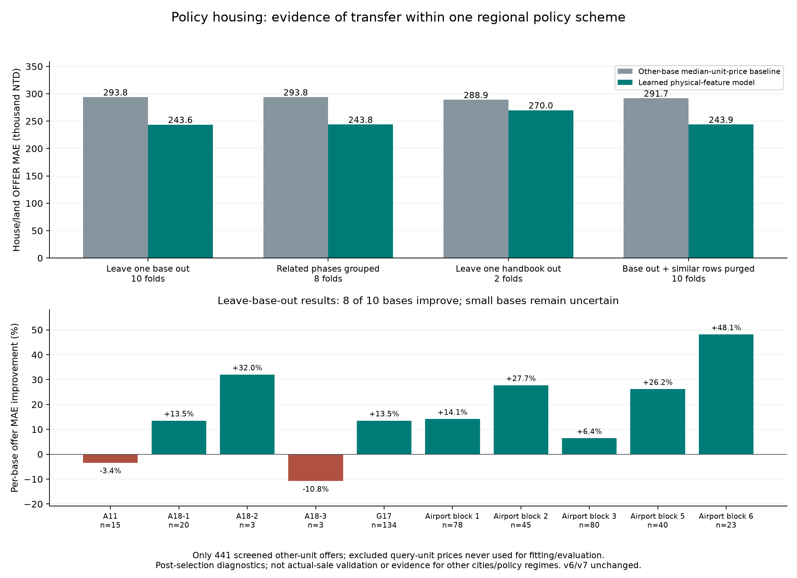

# 314580075｜ML2026@IAII - Regression｜Kaggle 1 Competition：技術細節

**學號**：314580075　**姓名**：黃駿甯

**主產物**：[submission1017_v7.csv](submissions/submission1017_v7.csv)　**備選**：[submission1017_v6.csv](submissions/submission1017_v6.csv)

**流程與執行條件**：[README](README.md)　**正式報告**：[PDF](report/report.pdf)

本文件沿著原始交易、特徵、學習目標、分支推論到 CSV 說明技術內容。所有實驗數字來自保存紀錄；算式示例明確標為假設輸入，不使用 test 真實價格。

## 0. 資料流與尺寸

```text
train Excel：455,787 列
  → 移除 3 列英文欄位說明與 8 列日期無效／超出範圍交易
  → 有效訓練交易：455,776 列
  → 各前向時間窗口各自 fitting 特徵、時間因子及房價模型

test：47,073 列
  → 一般住宅 v4 + 學習式安置住宅 → v6
  → 嚴格未見建案：28,374 列，加入兩個 seed 的地理增量
  → 其他：18,699 列，含 1,408 筆安置住宅，價格維持 v6
  → v7：47,073 列 × 2 欄（編號、總價元）

地理來源：360,587 筆 2020 A2 參考點
  → 排除 1 筆座標無效、65 筆行政區無法解析／不一致
  → 360,521 筆 → 13 個額外地理特徵

外部房地報價：1,845 戶
  → 排除 test 的 1,404 個同戶身分
  → 安全訓練資料：441 戶 × 6 個物理特徵，10 個基地
  → 另用 2,090 筆車位報價估計車位常數
```

test 的 1,408 是交易列數，1,404 是與外部手冊對應的同戶身分數，兩者不是同一個計數單位。

## 1. 原始資料與資料隔離

### 1.1 快取、型別與日期

[prepare.py](project/prepare.py) 使用 `python-calamine` 讀 Excel，先轉成字串保存 Parquet，避免門牌、中文樓層及 ID 被不同讀檔方式改寫。每份原檔計算 SHA-256；原檔雜湊改變時才重建快取。

這個階段的統計先移除目標欄，僅 train 額外計算目標分位數與無效值數。民國日期、中文數字、文字正規化等函式位於 [features.py](project/features.py)。後續資料流程依有效日期與訓練範圍選取交易；沒有把 `prepare.py` 的快取轉換誤當成完整清洗。

### 1.2 哪些資訊可以用在哪裡

| 資訊 | fitting／選模 | 推論 |
|---|---|---|
| train 成交總價 | 當折 fitting 標籤、歷史行情；留出窗口只評分 | 不可讀取 test 成交價 |
| 官方 valid 標籤 | 不加入 fitting | 不作輸入特徵 |
| test 物理屬性 | 不作房價監督標籤；用於預先指定的查詢身分排除與無標籤診斷 | 可使用提供欄位 |
| 外部房地報價 | 先排除 test 同戶，剩餘 441 戶才能訓練／驗證 | 保存的政策模型不讀逐戶價格表 |
| 建案／戶號 | 政策分支只作同戶排除與分組；一般住宅另有建案特徵 | 政策價格模型不用；不可將此結論誤套到全部一般住宅模型 |
| 備註明列減收差額 | 不擬合係數 | 依明列原額與減收後金額相減 |

字元 TF–IDF／SVD、類別編碼、歷史價格特徵與時間因子，都以當折 fitting 資料估計。使用未標註 test 的屬性做診斷不等於獨立盲測；本報告保留這項限制。

## 2. 面積尺度、時間因子與原價 MAE

令成交總價為 $y_i$，有效面積為 $A_i$，由 fitting 交易估計的時間因子為 $I_i$。部分模型使用：

$$
b_i=A_i I_i,\qquad z_i=\log(y_i/b_i).
$$

地理 CatBoost 學習 $z_i$，樣本權重為：

$$
w_i=\operatorname{clip}\!\left(\sqrt{y_i/10^7},\,0.2,\,6\right).
$$

程式以 `RMSE` 訓練；還原後再施加固定 0.5 的時間趨勢衰減：

$$
\hat p_i=\max\left\{1,\;b_i\exp[\operatorname{clip}(f(x_i),-10,20)]\exp[-0.5\log I_i]\right\}.
$$

因此不能把地理 CatBoost 的訓練 loss 說成原價 MAE。所有候選的採用與最終比較，仍回到：

$$
\operatorname{MAE}=\frac{1}{n}\sum_i|y_i-\hat p_i|.
$$

另一類分支學習單價。若使用面積權重，則：
$$
A_i\left|\frac{y_i}{A_i}-f(x_i)\right|=|y_i-A_i f(x_i)|.
$$

這說明單價表達如何對齊總價 L1；但加入正則化或時間衰減後，不能宣稱整個集成與無正則總價 L1 完全等價。實際程式：[train_geography.py](project/train_geography.py)。

## 3. 非價格地理特徵怎麼建立

### 3.1 固定來源與清理

[RoadGeography](project/geography_features.py) 只接受 `address, longitude, latitude, event_date` 四欄，並檢查所有事件在 2020 年。2020 A2 用來建立位置參考；2020 A1 只用來檢查定位誤差。

座標需在經度 118–123、緯度 21.8–26.5 範圍；再排除行政區無法解析或距其參考中位點超過 75 km 的紀錄。保留 360,521 筆。這些資料不包含住宅價格，沒有以實價登錄成交價回填 test。

### 3.2 定位階層

地址先拆成城市、行政區、道路、百號門牌區段與路口。各組保存座標中位數、點數，以及距組內中位點的第 90 百分位距離。

| 定位來源 | 最少參考點 | 最大組內分散距離（km） | 層級 |
|---|---:|---:|---:|
| 城市 | 10 | 200 | 1 |
| 行政區 | 5 | 75 | 2 |
| 道路 | 3 | 15 | 3 |
| 百號區段 | 3 | 2 | 4 |
| 路口 | 2 | 1 | 5 |

依表中順序更新，通過門檻的更細來源會覆蓋較粗位置；無法定位的欄位保留缺失。這是地址到位置的查詢，沒有住宅價格標籤，也不是外部同戶成交價查表。

### 3.3 13 個輸出特徵

| 類別 | 數量 | 內容 |
|---|---:|---|
| 位置 | 2 | 估計經度、緯度 |
| 品質 | 3 | 定位層級、`log1p(參考點數)`、分散距離 |
| 區域參考 | 6 | 城市／行政區各自的中位經度、緯度、距離 |
| 局部密度 | 2 | 1 km／3 km 內參考點數的 `log1p` |

密度以 haversine 距離的 BallTree 計算。區域中心是事故位置的參考中位點，不是官方行政中心；點密度亦不是交通可達性或事故風險的直接測量。所有輸出為 float32，train／test 道路或更細層級涵蓋率為 66.39%／70.98%。

來源與品質：[geocoder_audit.json](evidence/geography_v1/geocoder_audit.json)、[coverage.json](evidence/geography_v1/coverage.json)。

## 4. 安置住宅：從外部標籤學習

### 4.1 先排除同戶，再進入模型選擇

[train_policy_learned.py](project/train_policy_learned.py) 以正規化建案及戶號建立身分集合：

```python
blocked = unit_identity(test, "建案名稱", "棟及號")
keep = ~unit_identity(offers, "project", "unit").isin(blocked)
safe = offers.loc[keep].copy().reset_index(drop=True)
```

只有 `safe` 的 441 戶價格進入 fitting、交叉驗證與後續泛化診斷。外部排除名單的身分用於移除訓練列，不是推論時的價格索引。

早期 v5 曾接觸與查詢逐戶報價，已淘汰。不能把正式分支的同戶排除，描述成整段研究從未看過那些外部報價。

### 4.2 六個物理特徵

令 $A$ 為建物移轉面積扣除車位面積，$F$ 為移轉樓層，$T$ 為是否有露臺：

$$
x=\left[A/100,\;F/10,\;(F/10)^2,\;\mathbf1(F=1),\;\mathbf1(F=2),\;T\right].
$$

test 的露臺旗標只依備註中的「露台／露臺」辨識。政策推論函式不讀 ID、地址、建案、棟號或價格表。所有樓層與面積需有效，不以缺失輸入默默生成價格。

### 4.3 實際訓練目標與正則化

以已統一政策版本的房地報價 $y_i^{offer}$ 建立縮放單價：

$$
u_i=\frac{y_i^{offer}}{10^5 A_i},\qquad w_i=\frac{A_i}{\bar A}.
$$

先對六個特徵 fitting StandardScaler，再以 `QuantileRegressor(quantile=0.5, alpha=0.001)` 學習加權 pinball loss 及 L1 係數懲罰。其資料誤差項滿足：

$$
w_i\rho_{0.5}(u_i-\hat u_i)
=\frac{|y_i^{offer}-10^5 A_i\hat u_i|}{2\cdot10^5\bar A}.
$$

這裡 $\rho_{0.5}(r)=|r|/2$；比例常數在同一次 fitting 內固定。加權單價目標因此對齊房地報價總額的 L1，正則項另限制係數。

原始候選為單價中位數、中位數線性回歸及淺層 L1 樹。外層五折整基地留出、內層三折選模；以每基地等權 MAE 選擇，若距最佳 1% 內優先簡單模型。最終全資料選到線性回歸，但原始外層五折**不全都選它**；外層評估的是完整選模程序。

原始外層報價 MAE 為 **274,037.61 元**，基準 **302,284.67 元**。全資料選模時線性候選的 CV MAE 252,165.28 元不是另一份獨立測試成績。[原始紀錄](evidence/policy_learned_v1/verification.json)

### 4.4 車位與備註差額

$$
\hat P=10^5 A\hat u(x)+N_{park}\hat c_{park}-D_{note}.
$$

- $\hat c_{park}$：從 2,090 筆車位報價 fitting 的全域中位數，每位 950,000 元；不按建案查表。
- $N_{park}$：由交易筆棟數提供的車位數。
- $D_{note}$：僅取備註明列「原房屋價款－差額減收後房屋價款」。未列減收時為零；格式或金額關係不合法則報錯。

這個差額是帳務關係，不是回歸係數，也不保證等於完整合約的一切費用。舊手冊依公開政策統一報價版本，同樣是前處理規則，不能稱為模型自行學會政策改變。

### 4.5 用一個假設輸入走過推論

以下只是算式示例，不代表某戶 test 資料或已測得準確率：

```text
淨面積 A = 100 m²、樓層 F = 5、沒有露臺
物理特徵 = [1, 0.5, 0.25, 0, 0, 0]
假設模型輸出縮放單價 u_hat = 0.60
房地預測 = 0.60 × 100 × 100,000 = 6,000,000 元
若有 1 車位、備註明列減收差額 200,000 元
總價預測 = 6,000,000 + 950,000 − 200,000 = 6,750,000 元
```

整個過程不需要知道該戶在手冊上的配售價。

## 5. v7 如何選模、混合與輸出

### 5.1 凍結的跨年度流程

前兩個時間窗口要求：未見建案 MAE 各改善至少 0.5%，後八個月不退步，且勝過相同混合權重的無地理特徵對照。候選只比較 CatBoost／LightGBM 與 25%／50% 權重。

先凍結選擇，再檢查第二 seed；各 seed 都須改善，兩 seed 平均仍須通過門檻。第三年度沿用相同選擇，檢查未見建案改善、後八個月與建案群組 bootstrap。確認窗口曾在前期研究使用，這種凍結只能限制本輪調整，不能消除所有歷史選模偏誤。

### 5.2 分支條件

`cold_mask` 同時檢查正規化建案鍵與原始名稱在 fitting 中未見，且 `sem_relocation == 0`。正規化建案鍵缺失時，程式使用行政區與地址基底建立分組鍵。

$$
\hat y_i^{(7)}=\begin{cases}
0.5\hat y_i^{(6)}+0.5\left(\hat y_i^{geo,1}+\hat y_i^{geo,2}\right)/2,&i\in\mathcal C,\\
\hat y_i^{(6)},&i\notin\mathcal C.
\end{cases}
$$

28,374 筆屬於 $\mathcal C$。其餘 18,699 筆不變，包括全部安置住宅；v6／v7 的政策分支沒有不同的人工折價係數。

### 5.3 輸出與保存模型重現

輸出依原 test ID 對齊，使用整數四捨五入。保存模型的獨立推論檢查會重建地址表示、面積、時間、語義及地理特徵，核對兩個 seed 預測、混合結果與全部提交值。

| 檔案 | SHA-256 |
|---|---|
| v6 | `53bde5d7fa8c97d95ab8897c905b38cf01e16cda6a6eea48f8605a5b848aadd6` |
| v7 | `c6984c5d86f20e794c774d65c52bdf46e4c0b2c7012ad57ff33f43982cc8eda7` |

詳見 [reproduction.json](evidence/geography_v1/reproduction.json) 與 [verify_geography.py](project/verify_geography.py)。這驗證已保存模型可重現 CSV，不保證不同硬體從零訓練得到同一組權重。

## 6. 如何檢查 overfitting 與 GENERAL

### 6.1 一般住宅的容量與群組診斷

對三年度、有／無地理特徵、兩個 seed，共 12 個 CatBoost 模型，檢查 500、1,000、1,500、2,000、2,500、3,000 棵樹。每年度固定抽 50,000 筆訓練樣本，並使用全部未來驗證交易。

三年度地理集成的未見建案 MAE 在六個檢查點均下降，沒有看到該範圍內的整體後期反彈。但未來資料的加權 log-RMSE 仍約為訓練重推的 2.13–4.14 倍，且約 45% 建案退步。時間漂移、類別統計與模型記憶均可能影響落差，不能因此宣稱完全沒有過擬合。

排除改善總額最大的十個建案後，各年度仍改善 1.20%、0.50%、1.84%；2022 年按城市重抽樣的區間仍含零。完整數字見 [診斷報告](evidence/overfitting_v7/REPORT.txt)。

### 6.2 政策分支是否依賴身分／同戶價格

原 1,408 筆查詢通過以下檢查：

| 檢查 | 已保存的觀察 | 能支持的結論 |
|---|---|---|
| 移除／替換 ID、地址、建案、棟號與新增價格欄 | 預測不變 | 正式政策推論不以這些欄位找價 |
| 打亂列順序、分批與重複查詢 | 還原順序後相同 | 不依資料列位置套價格 |
| 模型載入後封鎖檔案讀取 | 推論成功 | 推論不需要逐戶價表 |
| 被排除身分拼上合成極端價格 | 安全資料與重現模型保持相同 | 這些身分被排除；未把真實被排除價當測試標籤 |
| 整基地／相關基地／整手冊留出 | 同政策內有平均改善 | 有跨群組訊號，仍非跨所有政策或成交價驗證 |

### 6.3 追加分組測試與負結果

追加診斷始終只使用原 441 戶安全標籤，正式模型與提交檔不改動。

| 切分方式 | 折數 | 模型報價 MAE（元） | 相對當折基準改善 |
|---|---:|---:|---:|
| 整基地留出 | 10 | 243,592 | 17.08% |
| A18 相關三期合併 | 8 | 243,835 | 17.01% |
| 整份手冊留出 | 2 | 269,994 | 6.54% |
| 基地留出後，再排除同樓層／同露臺且面積差 ≤1 m² 的樣本 | 10 | 243,874 | 16.40% |

另外以原三候選做內層三折相關基地選模，在基地、基地家族、來源及相似樣本排除四種切分合計 30 個外層折，皆選到原線性候選。這與原始五折不是相同資料量或切分，不能把較低的數字宣稱為正式模型又改善。

整基地留出有 8 個基地改善、2 個退步；其中兩基地各僅 3 戶。跨手冊改善的基地重抽樣區間含零，而兩份手冊都屬同一地區政策體系。

移除與任意 test 戶相似的 304 戶、只用其餘 137 戶重訓診斷模型後，房地預測變動中位數 0.66%、P95 2.41%。這是沒有 test 標籤的穩定性，**不是 test MAE**。二十次打亂單價與特徵對應的負對照皆較差；因價格不具可交換性，不換算成正式 p 值。



完整設定與負結果：[protocol.json](evidence/policy_generalization_v1/protocol.json)、[REPORT.txt](evidence/policy_generalization_v1/REPORT.txt)。

## 7. 證據的邊界與重現入口

1. test 無真實成交價，private score 未知；政策報價不能代替成交標籤。
2. 歷史窗口與外部報價研究均存在先前接觸，不能稱為全新盲測。
3. 外部資料的可用日期須與預測情境對齊；政策來源並非全部早於 train 截止日。
4. 沒有因 public 分數去調整特定戶、特定建案或額外折價常數；v5 查表候選明確淘汰。
5. [README](README.md) 提供環境、分階段入口與結果；[REPRODUCIBILITY.txt](REPRODUCIBILITY.txt) 列出模型、資料及快取的必要條件。合成測試與檔案雜湊不能代替完整模型重訓或新市場評估。

本技術文件依指定參考 repo 的「資料流、程式、公式、逐步推論」方式撰寫；沒有搬用 LLM 訓練的超參數、實驗結果或結論。學號與姓名同時保留在主文件、技術文件及 PDF。
